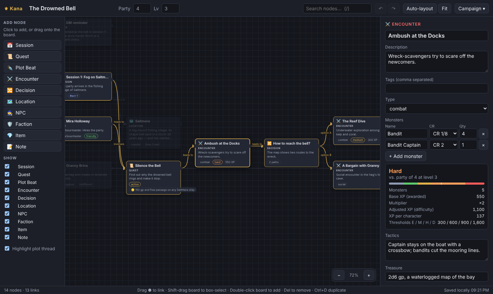

# Kana — D&D 5e Campaign Plotter

A node-based campaign planner for Dungeons & Dragons 5th edition. Lay out quests, sessions,
encounters, NPCs, locations and decisions as cards on an infinite board, wire them together, and
see how your plot threads branch and converge, with live encounter difficulty built in.



## Running it

No build step and no dependencies. Open `index.html` in any modern browser.

To serve it locally instead (for example, to reach it from another device):

```sh
npm start          # python3 -m http.server 8080 → http://localhost:8080
```

Your campaign autosaves to the browser's local storage. Use **Campaign → Export JSON** to back it
up or move it to another machine, and **Import JSON** to load it back.

## Features

- **Ten node types:** Session, Quest, Plot Beat, Encounter, Decision, Location, NPC, Faction, Item
  and Note. Each has 5e-flavoured fields (quest status and rewards, NPC alignment, attitude,
  motivation and secrets, item rarity and attunement, and so on).
- **Links with labels** (*leads to*, *requires*, *involves*, *located at*, *rewards*…). Drag from a
  node's right-hand ● onto another node. Drop on empty board to create a new node that is already
  linked.
- **Plot-thread highlighting:** select a node to light up everything that leads to it and
  everything it unlocks.
- **Encounter builder:** add monsters by CR and quantity, and get the DMG difficulty (easy,
  medium, hard or deadly). It applies the group-size multiplier and the small and large party
  adjustments, against the party size and level set in the top bar. Cards show the difficulty
  at a glance and update when the party levels up.
- **Campaign overview:** node counts, quest status, encounter difficulty spread, total XP on the
  board, the projected party level after clearing it, the daily XP budget, and the campaign's
  entry points.
- **Board tools:** pan, zoom, grid snapping (hold Alt for free movement), box-select, duplicate,
  undo/redo, search, per-type show/hide filters and auto-layout by plot order.
- **Export** to JSON, or to a Markdown outline you can print or paste into your session notes.

## Controls

| Action | How |
| --- | --- |
| Add node | Click a palette item, drag it onto the board, or double-click / right-click the board |
| Link nodes | Drag from a node's right-hand ● to another node |
| Pan | Drag empty board, or middle-mouse drag |
| Zoom | Mouse wheel, `+` / `-`, or the zoom buttons |
| Box select | Shift + drag on empty board |
| Multi-select | Shift / Ctrl + click |
| Delete | `Delete` / `Backspace` |
| Duplicate | `Ctrl+D` |
| Undo / redo | `Ctrl+Z` / `Ctrl+Shift+Z` (or `Ctrl+Y`) |
| Fit to view | `F` |
| Search | `/` (press Enter to jump to the first match) |
| Deselect | `Esc` |

## Project layout

```
index.html        App shell
css/styles.css    Styles
js/rules.js       5e encounter maths (XP thresholds, CR→XP, multipliers, level progression)
js/model.js       Node types, graph queries, auto-layout, import validation
js/sample.js      The bundled starter adventure, "The Drowned Bell"
js/app.js         Board rendering, interaction, inspector, persistence, export
test/             Unit tests for rules.js and model.js
```

`rules.js` and `model.js` are DOM-free and run in both the browser and Node.

```sh
npm test
```

Encounter maths follows the 2014 *Dungeon Master's Guide* (chapter 3, "Creating a Combat
Encounter").
